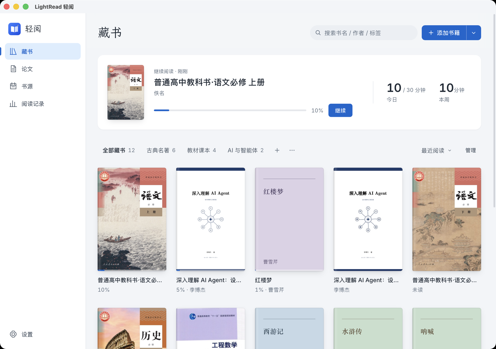
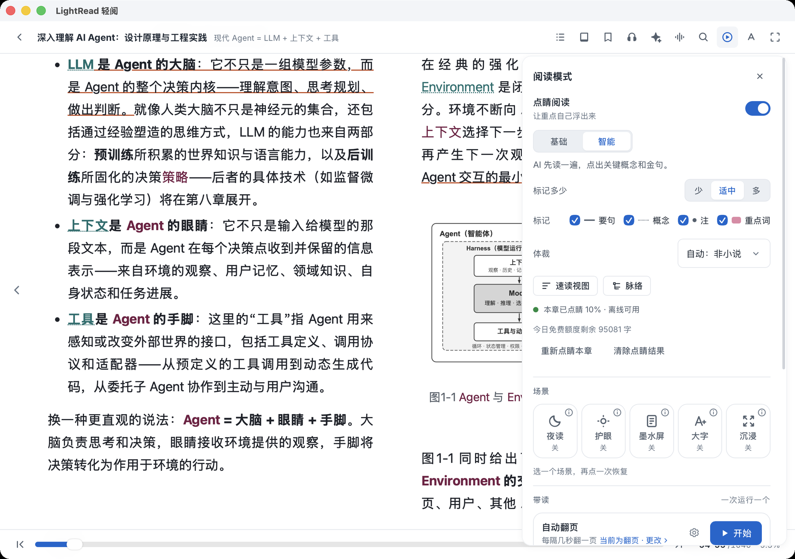
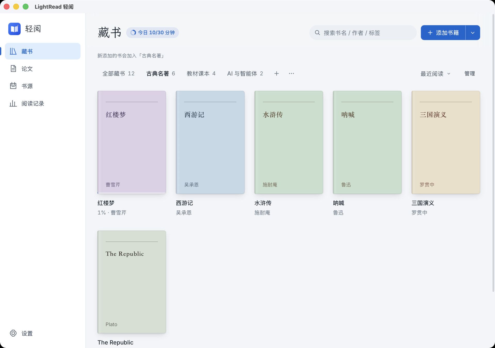
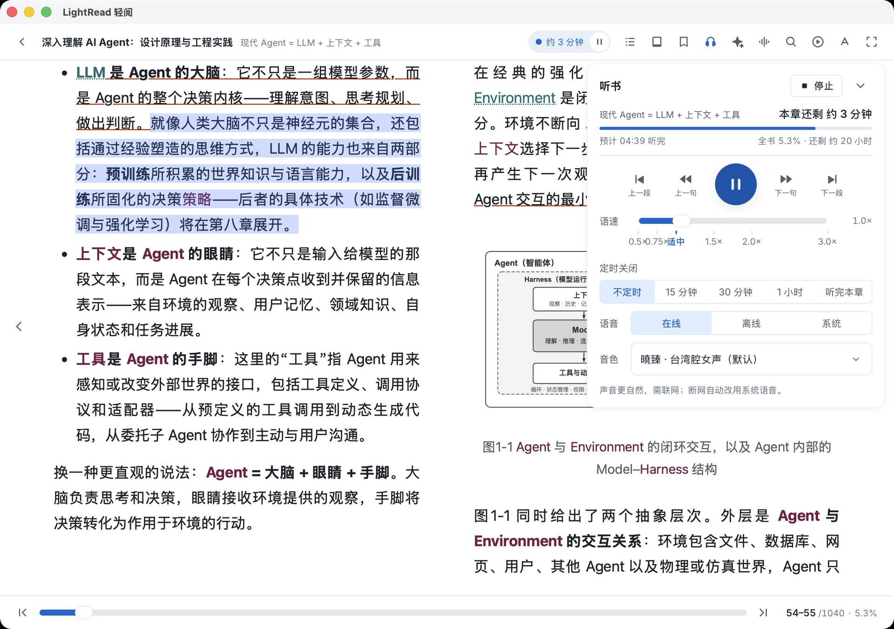
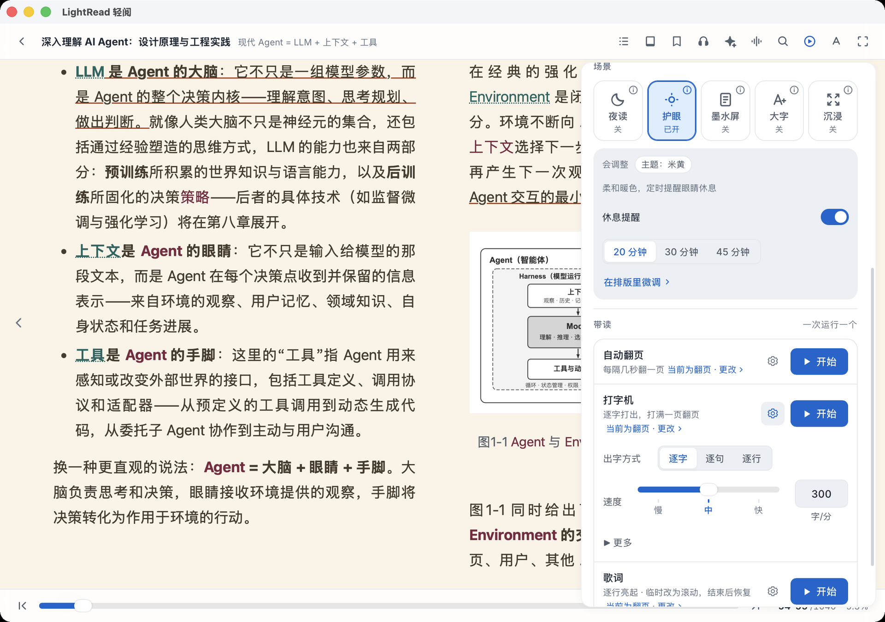

<div align="center">


# LightRead 轻阅 · 开源免费的全格式电子书阅读器

**让想读的书，变成读进去的书。**

EPUB / PDF / MOBI / AZW3 / TXT 全格式 · 点睛阅读 · 多种阅读模式 · 听书 · PDF 对照翻译 · 多端同步

[中文](README.md) · [English](README.en.md)

[](https://github.com/yzfly/LightRead/releases/latest)
[](https://github.com/yzfly/LightRead/releases)
[](LICENSE)

**[官网](https://code.jiangshu.ai/LightRead/)** · **[下载桌面版](https://code.jiangshu.ai/LightRead/#download)** · **[下载安卓 App](https://code.jiangshu.ai/LightRead/download/android)** · [国内镜像（GitCode）](https://gitcode.com/langgpt/LightRead/releases) · [使用手册](https://code.jiangshu.ai/LightRead/manual/) · [反馈建议](https://github.com/yzfly/LightRead/issues)

Windows · macOS · Linux · Android · 网页 PWA

免费、开源、无广告。本地阅读无需账号、无需联网；藏书、进度与笔记默认留在自己的设备上。



</div>

[PDF 翻译](#pdf-翻译外文资料也能读进去) · [点睛阅读](#点睛阅读让重点自己浮出来) · [书单](#书单把想读变成下一本) · [阅读记录](#阅读记录看见每天读过的时间) · [听书与专注](#听书与专注找到自己的阅读节奏)

## 一眼看懂轻阅

| | |
| --- | --- |
| 是什么 | 开源、本地优先的电子书与 PDF 阅读器，读书、读论文、听书都在一个应用里 |
| 支持设备 | Windows 10 / 11、macOS（Apple 芯片与 Intel）、Linux（deb / rpm / AppImage）、Android（arm64）、网页 PWA |
| 支持格式 | EPUB、PDF、MOBI、AZW、AZW3、FB2、TXT、Markdown、HTML、DjVu、CBZ / CBR 漫画，以及代码、日志等纯文本文件 |
| 阅读模式 | 点睛阅读（重点词 / 要句标记）、打字机、歌词、仿生阅读、自动翻页与匀速滚动、听书跟读；夜读、护眼、墨水屏、大字、沉浸场景 |
| 排版 | 翻页 / 按章滚动 / 跨章连续滚动，单栏 / 双栏，字号、行距、边距、字体、主题随手调；App 支持音量键翻页、PDF 重排 |
| 多端 | 轻阅账号或 WebDAV 同步进度、笔记、书签、书单、阅读记录与设置；藏书包导入导出 |
| 费用与隐私 | 免费，AGPL-3.0 开源；不需要账号即可使用，联网功能按需开启 |
| 不支持 | KFX 与 DRM 加密文件 |

## 手机 App

安卓 App 与桌面版共用同一套阅读引擎，界面按手机重新设计：底部标签栏、单手可达的阅读工具栏、底部抽屉面板。

| 藏书 | 正文 · 点睛阅读 | 阅读模式 | 排版 · 音量键翻页 |
| --- | --- | --- | --- |
|  |  |  |  |

| 听书 | 书源 | 阅读记录 |
| --- | --- | --- |
|  |  |  |

<sub>App 截图由 App 界面在手机尺寸（390 × 844）的浏览器中渲染，示例书与阅读记录为演示数据；真机上听书默认使用在线语音。[截图复现说明](docs/screenshots/README.md)</sub>

## 本地书库，把散落的好书放在一起

拖入文件，就能开读。用**封面书架、标签、书单和阅读进度**整理藏书；论文有独立入口，读书与研究各得其所。

支持 **EPUB、PDF、MOBI、AZW / AZW3、TXT、Markdown**，以及 FB2、CBZ / CBR 漫画、DjVu、HTML 和代码、日志等纯文本文件；MOBI、AZW3、FB2、TXT 还能一键转成 EPUB。不支持 KFX 和 DRM 加密文件。

## PDF 翻译，外文资料也能读进去

**原文在左，译文在右。** 划词翻译、逐页版式对照，边读边标注；桌面端还可用 **BabelDOC** 生成中文或双语 PDF。


想再读深一点？桌面端的**论文 Agent 与论文十问**帮你追问论点、方法和证据，你写下的答案单独保留。[查看论文阅读指南 →](docs/paper-reading.md)

<details>
<summary>翻译与 AI 的使用条件</summary>

逐页和划词翻译使用配置的 AI 服务。BabelDOC 仅限桌面端，需额外安装运行环境与模型，并配置个人模型服务；可能产生服务商费用。论文 Agent 需安装并配置 Pi、Codex 或 Claude Code 中的一个引擎。扫描 PDF 可显示，但选文与文字分析需要文本层；目前不内置 OCR。

</details>

## 点睛阅读，让重点自己浮出来

**基础版离线标出词语与重点词；智能版用 AI 点出要句、概念和注释。** 读长文时抓住线索，复习时用章节要义、全书脉络和速读找回重点。



图为基础版。智能版需同意后调用 AI 服务。适用于 EPUB、TXT 等流式电子书，暂不支持 PDF 和固定版式书籍。[了解点睛阅读 →](docs/manual/05-点睛阅读.md)

## 书单，把「想读」变成「下一本」

**读过的、在读的、还没找到的，都能放进同一张书单。** 支持待找清单、自动匹配入库、推荐书单和导出分享，让阅读计划有个落脚点。



## 阅读记录，看见每天读过的时间

**今天读了多久，这周读了什么，哪本书陪你最久。** 每日目标、连续阅读、周月年趋势与阅读日历，把零散的阅读时间慢慢积累起来。


## 听书与专注，找到自己的阅读节奏

**眼睛累了就听，想专注就换一种读法。** 听书支持调速、定时关闭与断点续听；还有打字机、歌词、自动翻页、背景音，以及夜读、护眼和大字场景。

| 听书：让书读给你听 | 阅读模式：按自己的节奏读 |
| --- | --- |
| [](docs/screenshots/feature-listen.png) | [](docs/screenshots/feature-reading-modes.png) |

桌面端支持在线语音、可下载的离线模型与系统语音；网页版使用系统语音。[听书与背景音 →](docs/manual/03-声音.md)

## 公开书源，从「想读什么」到开始阅读

**搜书、找论文、逛书单，在一个入口完成。** 连接古登堡计划、Internet Archive、arXiv、OPDS / Calibre 或自建书库。


推荐书单在「设置 → 功能」中开启。书源的可用性、下载条件与授权范围以来源为准。[自建书库指南 →](docs/self-hosted-library.md)

## 换台设备，也能接着读

| 你想做的事 | 轻阅提供的方式 |
| --- | --- |
| 手机、电脑接着读 | 轻阅账号同步进度、笔记、书签、书单与阅读记录；书籍文件需另行导入 |
| 连书一起同步 | WebDAV 可选同步书籍文件，连接自己的网盘或 NAS |
| 发一段文字、一份文件 | 互传支持账号、WebDAV 与临时取件码通道 |
| 备份或搬家 | 导入 / 导出 `.okf.zip` 藏书包，桌面端可自定义书库位置 |
| 把想法留在书里 | 划线、批注、书签与书内搜索，回到上次读过的位置 |

本地数据默认留在设备上。在线书源、语音、AI 和同步按所用服务联网；远程 AI 会接收相应文本。藏书包不包含应用设置、凭据和 Agent 工作目录。[同步与备份说明 →](docs/manual/04-使用说明.md#8-多端同步)

## 下载与安装

桌面版和安卓 App 分开发版，各自的最新版都在下面的渠道里。已安装的应用会在应用内提示更新。

| 渠道 | 地址 | 适合 |
| --- | --- | --- |
| 官网固定链接 | `https://code.jiangshu.ai/LightRead/download/<平台>`：[windows](https://code.jiangshu.ai/LightRead/download/windows) · [mac](https://code.jiangshu.ai/LightRead/download/mac) · [mac-intel](https://code.jiangshu.ai/LightRead/download/mac-intel) · [linux](https://code.jiangshu.ai/LightRead/download/linux) · [linux-deb](https://code.jiangshu.ai/LightRead/download/linux-deb) · [linux-rpm](https://code.jiangshu.ai/LightRead/download/linux-rpm) · [android](https://code.jiangshu.ai/LightRead/download/android) | 链接不变，始终下载最新版；加 `?mirror=gitcode` 走国内镜像 |
| GitHub Releases · 桌面版 | [github.com/yzfly/LightRead/releases/latest](https://github.com/yzfly/LightRead/releases/latest) | Windows、macOS、Linux |
| GitHub Releases · 安卓 App | [以 `app-v` 开头的版本](https://github.com/yzfly/LightRead/releases?q=app-v&expanded=true) | Android 手机、平板 |
| GitCode 国内镜像 | [gitcode.com/langgpt/LightRead/releases](https://gitcode.com/langgpt/LightRead/releases) | 访问 GitHub 慢时使用，桌面版与 App 均有 |
| 应用内更新 | 设置 → 关于 → 检查更新 | 已安装用户；GitHub 访问不了时自动改用 GitCode 镜像 |
| 源码构建 / 网页版 | 见下方「开发者：从源码运行」 | 自行部署网页 PWA 或二次开发 |

按设备选择安装包（`x.y.z` 为版本号）：

| 设备 | 安装包 |
| --- | --- |
| Windows 10 / 11（64 位） | `LightRead_x.y.z_x64-setup.exe` |
| macOS · Apple 芯片（M 系列） | `LightRead_x.y.z_aarch64.dmg` |
| macOS · Intel | `LightRead_x.y.z_x64.dmg` |
| Ubuntu / Debian | `LightRead_x.y.z_amd64.deb` |
| Fedora / RHEL | `LightRead-x.y.z-1.x86_64.rpm` |
| 其他 Linux | `LightRead_x.y.z_amd64.AppImage` |
| Android 7.0+（arm64） | `LightRead_app-vx.y.z_android_arm64.apk` |

每个版本附带 `SHA256SUMS`，可核对下载文件是否完整。安装后，把第一本书拖进轻阅即可开始。[完整安装与升级指南](docs/installation.md) · [三分钟上手](docs/manual/README.md#三分钟上手)

<a id="android实验性"></a>
**Android 说明：** App 目前是实验版（包名 `com.yzfly.lightread.debug`），同签名新版可直接覆盖升级。历史版本可能签名不同；遇到安装冲突，先保留旧应用，导出并验证应用目录外的备份，再按[迁移步骤](docs/installation.md#android实验性)操作。

<details>
<summary>开发者：从源码运行</summary>

网页版需要 Node.js；桌面版还需要 Rust 与对应平台的 Tauri 2 构建依赖。

```bash
git clone https://github.com/yzfly/LightRead.git
cd LightRead
npm install
npm run dev          # 网页开发
npm run tauri dev    # 桌面开发
```

构建：`npm run build`（前端）或 `npm run tauri build`（桌面）。技术栈：Vue 3、TypeScript、Tauri 2 / Rust、foliate-js、MuPDF / PDFium。开发约定见 [CLAUDE.md](CLAUDE.md)。

</details>

## 一起把轻阅做得更好

喜欢轻阅，欢迎 **[Star](https://github.com/yzfly/LightRead)**，也欢迎[提出建议](https://github.com/yzfly/LightRead/issues)、提交 PR 或推荐合法公开书源。

作者：**江树 / 云中江树** · 微信：**1796060717**（备注 `LightRead`）· 微信公众号：**云中江树**

<sub>本页为实际应用界面截图；书架、阅读记录与 PDF 译文使用演示数据，示例读物与封面为本项目制作，不随应用附送。[截图复现说明](docs/screenshots/README.md)</sub>

## 开源协议

[GNU Affero General Public License v3.0 or later](LICENSE)

LightRead 使用 AGPL 授权的 MuPDF，因此项目整体以 AGPL-3.0-or-later 发布。分发修改版或通过网络向用户提供修改版服务时，须依照协议提供对应源代码。

致谢：[foliate-js](https://github.com/johnfactotum/foliate-js) (MIT) · [MuPDF](https://mupdf.com/) (AGPL-3.0-or-later) · [PDFium](https://pdfium.googlesource.com/pdfium/) (BSD-3-Clause) · [BabelDOC](https://github.com/funstory-ai/BabelDOC) · 中文词表取自 [jieba](https://github.com/fxsjy/jieba) 词典 (MIT) 与 [DeepSeek-R1](https://huggingface.co/deepseek-ai/DeepSeek-R1) 分词器词表 (MIT)
